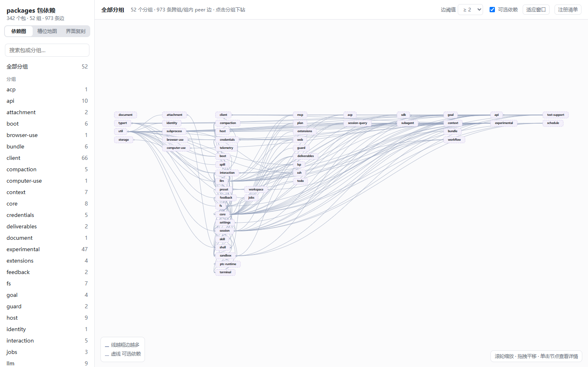
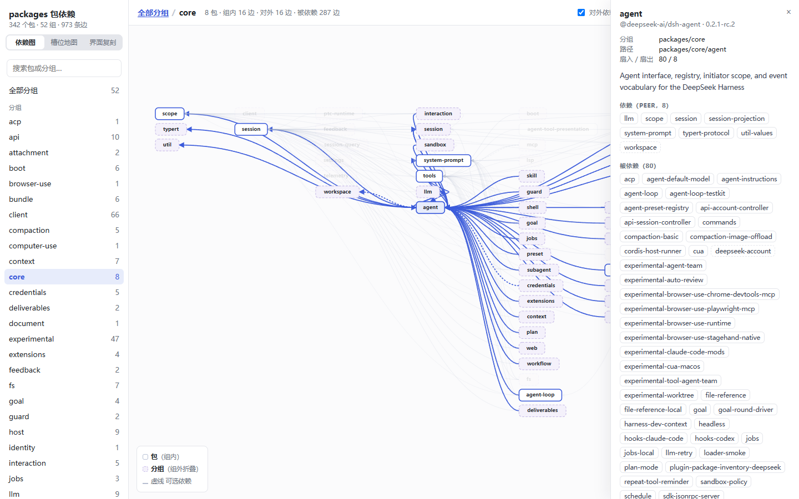
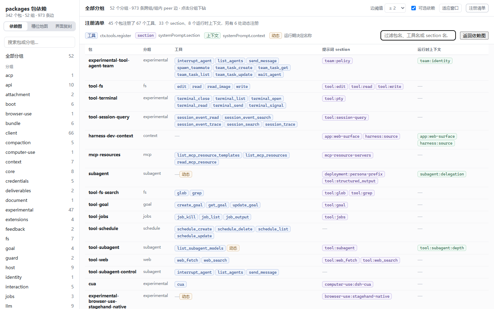
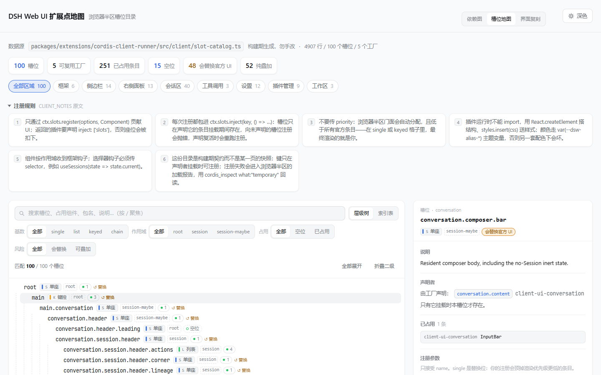
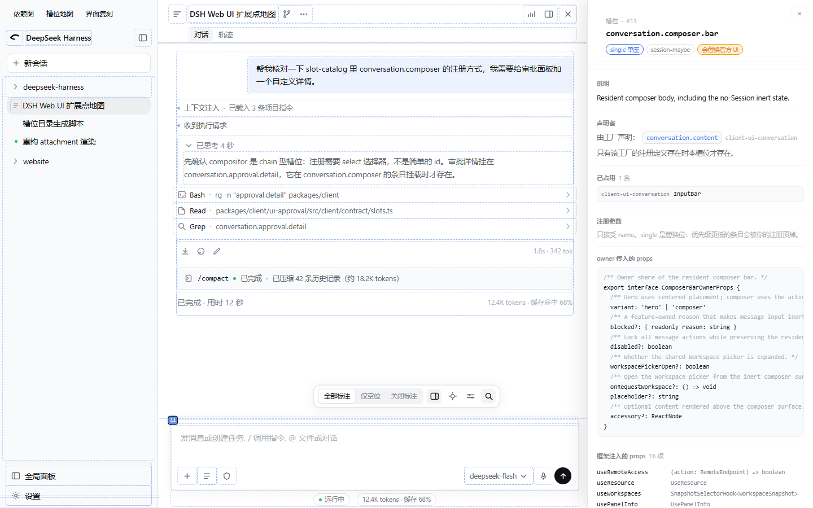

# dsh-learn

### **在线使用 → <https://juexe.github.io/dsh-learn/>**（无需安装，打开即用）

[DeepSeek Harness](https://github.com/deepseek-ai/deepseek-harness) 的静态分析与可视化，三个页面互相链接：

| 页面 | 内容 |
| --- | --- |
| [依赖图](deliverables/index.html) | 342 个包、52 个分组、973 条 `peerDependencies` 边，以及全部工具、提示词 section 与运行时上下文的注册点 |
| [槽位地图](deliverables/slots.html) | 浏览器半区 100 个槽位的编译期契约：声明层级、占用情况、注册参数与可复制示例 |
| [界面复刻](deliverables/slots-ui.html) | 按真实布局复刻的 Web GUI，槽位以热点标出并可点选查看契约 |

全部为**单文件页面**——零依赖、无外部请求，也能下载下来离线打开。

[](https://juexe.github.io/dsh-learn/)
[](https://nodejs.org/)
[](LICENSE)

## 能回答什么

- 谁依赖了 `session`？哪些包才是真正的枢纽？
- 有多少跨组依赖？依赖图里有环吗？最深的链有几层？
- 哪些包注册了模型可调用的工具？名字是写死的还是运行期算出来的？
- 我想给对话区加一个自定义渲染，该注册到哪个槽位？它什么时候才存在？会不会顶掉官方 UI？

## 依赖图



点击节点下钻或查看详情，滚轮缩放、拖拽平移，`/` 聚焦搜索，`Esc` 返回上一层；当前分组写在 URL hash（`#group/core`）里，可直接分享。

<table>
<tr>
<td width="50%"></td>
<td width="50%"></td>
</tr>
<tr>
<td align="center">点选节点高亮它的直接依赖与被依赖</td>
<td align="center">注册清单可按包名、工具名或 section 名过滤</td>
</tr>
</table>

## 槽位地图



按声明层级列出全部槽位，虚线表示「谁让这个位置存在」——父级条目没挂载，子槽位就不存在。点任意键名，右侧显示它的完整契约：占用条目、键域、注册参数、owner 与框架 props、最小可用示例（可复制）。

可按基数（`single` / `list` / `keyed` / `chain`）、作用域、是否空位、是否替换官方 UI、界面区域筛选，也能切到索引表排序查看。`#conversation.composer` 形式的深链可直接定位到某个槽位。

## 界面复刻



把同一份契约画在真实布局上。悬停虚线区域浮出「序号 + 键名 + 基数 + 占用数」，点开可看完整契约；右上角检查器提供全量索引与四类基数的图例。

带行为的元素（发送键、设置入口、工具行）保留各自行为，检查它们的座位用 **Alt+点击**。标注可切三态：全部 / 仅空位 / 关闭。

## 当前数据

对 `dsh` `0.2.1-rc.2` 检出的结果：

| 指标 | 值 |
| --- | --- |
| 包 / 分组 / peer 边 | 342 / 52 / 973（其中可选边 40） |
| 跨组边 / 组内边 | 833 / 140 |
| 依赖环 | 0；最长依赖链 12 层 |
| 扇入最高 | `session` 100、`llm` 93、`agent` 80 |
| 工具 / section / 运行时上下文 | 67 / 33 / 8，来自 45 个包；另有 6 处动态注册（按「包 + 名称」去重） |
| 槽位 / 可复用工厂 | 100 / 5；占用 251 条，空位 15，48 个会替换官方 UI |

槽位按基数分为 `single` 43、`list` 37、`keyed` 17、`chain` 3；按界面区域分为会话区 40、侧边栏 14、右侧面板 13、设置 12、插件管理 9、框架 6、工具调用 3、工作区 3。

## 本地重建

页面已随仓库发布，一般不需要重建。要对自己的 harness 检出重新生成：

```sh
git clone https://github.com/juexe/dsh-learn.git && cd dsh-learn

export DSH_REPO_ROOT=/path/to/deepseek-harness   # 也可用 --root <path> 或 repo-root.local.json
pnpm build && pnpm check
pnpm serve
```

需要 Node.js `>= 22.19`；零依赖，`pnpm install` 可以跳过。根路径按 `--root` → `DSH_REPO_ROOT` → `repo-root.local.json` → `repo-root.json` 解析，指向无效目录会直接报错。

## 原理

```text
extract    packages/*/*/package.json   → data/packages.json
analyze    扇入扇出、分组聚合、Tarjan   → data/analysis.json
scan       packages/*/*/src/**/*.ts    → data/registrations.json
page       以上数据 + 页面模板          → deliverables/index.html
slots      外部检出 slot-catalog.ts     → data/slots.json
slots:page 槽位数据 + 槽位地图模板      → deliverables/slots.html
slots:mock 槽位数据 + 模拟器模板        → deliverables/slots-ui.html
check      数据不变量 + 工具目录交叉验证
```

脚本都在 `scripts/`，页面模板在 `src/`。`data/` 是 Git 忽略的中间产物，`deliverables/*.html` 作为可审阅的构建产物入库。CI 在部署前跑 `verify-page.mjs` 与 `verify-slots-pages.mjs`，两页数据漂移都会让部署失败。

三条刻意的约束：

- **不臆造数据**。注册名只在能从字面量、同文件常量、跨包导出、工厂函数、配置默认值或模板插值中确定时给出；确定不了的标为「动态」，并保留源码位置。
- **交叉验证**。`crosscheck-tools.mjs` 把静态扫描与检出中运行期生成的 `docs/tool-catalog.md` 逐项对比，差异必须命中已知且可解释的规则，否则失败——用来暴露提取器的盲区。
- **槽位以模块方式读取**。`slot-catalog.ts` 是检出中的生成文件，直接 `import()` 它的导出数组，不用正则重新推导——后者会静默漂移。

## 已知限制

- 只分析 `packages/<group>/<pkg>`，不含 `apps/`、`native/`、`vendor/`。
- 只扫 `.ts`（跳过 `.spec.ts`、`.d.ts`、`node_modules`），正则解析、不构建语法树。
- `verify-page.mjs` 固定了当前检出的总量，跟进上游版本时需同步更新期望值；`verify-slots-pages.mjs` 只做结构校验，因为新增座位本就会改变总数。
- 槽位契约读取的是检出中的生成文件 `packages/extensions/cordis-client-runner/src/client/slot-catalog.ts`，上游移动该路径时需同步更新 `scripts/extract-slots.mjs`。
- 界面复刻是静态模拟：浮层、列表为空或条目返回 `null` 的座位在页面上没有可见区域（当前状态 39 个可见、61 个不可见），改从检查器的全量索引进入。

## License

[MIT](LICENSE)
